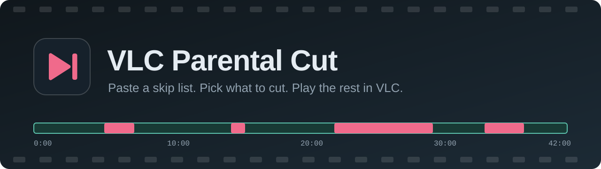
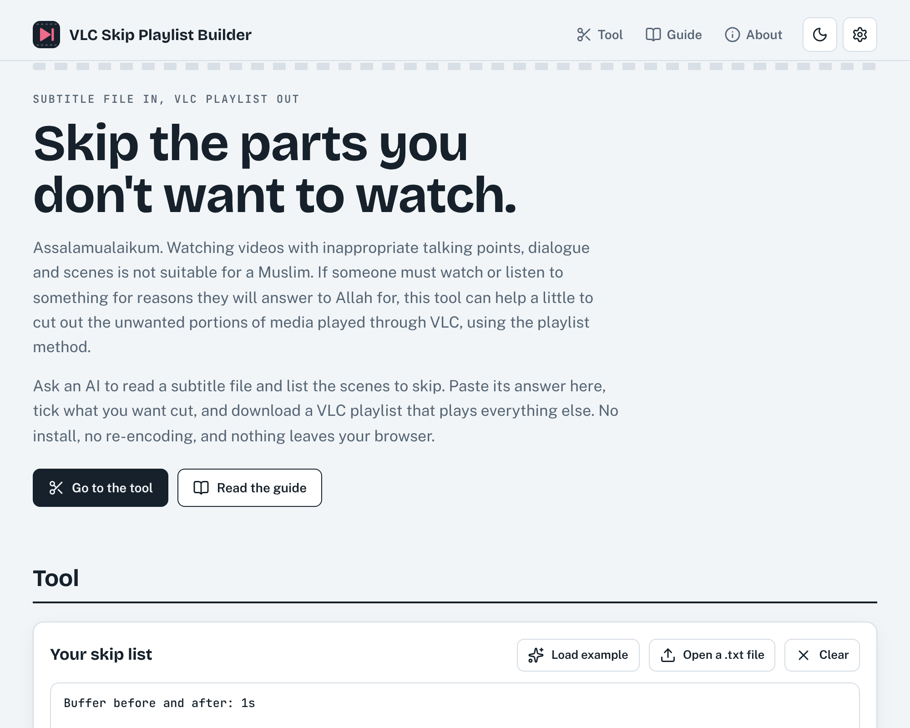
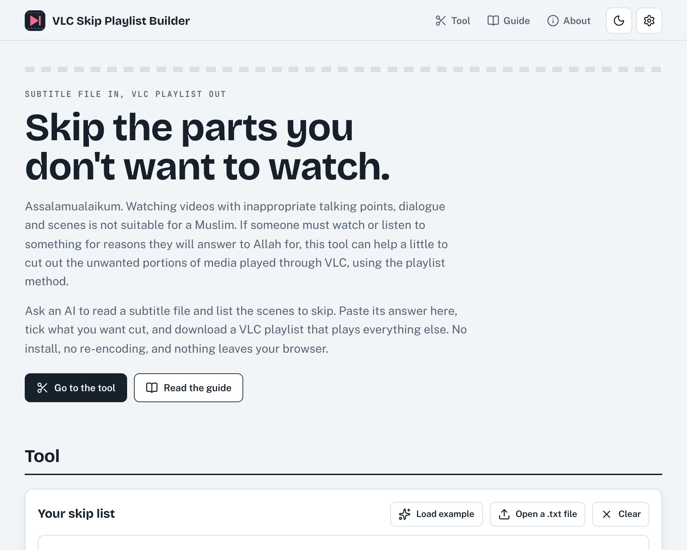

<p align="center">
  
</p>

<p align="center">
  <a href="https://rijwanul.github.io/VLC-parental-cut/"></a>
</p>

<p align="center">
  
  
  
  
  
  
  
</p>

<h1 align="center">VLC Parental Cut</h1>

<p align="center">
Paste a list of time ranges, tick what to cut, and download a <b>VLC playlist</b> that plays everything else.<br>
It never edits your video. It runs in your browser. Nothing is uploaded.
</p>

<p align="center">
  
</p>

## Why

Assalamualaikum. Watching videos with inappropriate talking points, dialogue and scenes is not suitable for a Muslim. If someone must watch or listen to something for reasons they will answer to Allah for, this tool can help a little to cut out the unwanted portions of media played through VLC, using the playlist method.


Some videos have a few scenes you would rather not watch. Skipping by hand means watching the clock. This tool turns a skip list into a `.m3u` playlist that VLC plays as a series of parts, jumping over each cut. Press `N` for the next part if you ever need to move by hand.

The skip list can come from anywhere. The page includes a ready-made prompt so an AI assistant can build it from a subtitle file.

## Features

| | |
|---|---|
|  **Paste or type** | Paste a list in plain text. The page below it builds itself and updates as you type. |
|  **Edit anywhere** | Change times in the rows, add or remove ranges, set buffers and runtime per episode, or rewrite the text. All views stay in sync. |
|  **Settings** | Series name, default buffers, shortest part to keep, playlist file name pattern, per-episode code, title, runtime and file name. |
|  **Check and uncheck** | Tick ranges to cut. Ranges listed under `Others-` stay in unless you tick them. |
|  **File matching** | Paste the output of `dir /b` or `tree /f`. Episodes are matched to video files by their `S01E02` code. |
|  **Download** | One `.m3u` per episode, or every episode in a single `.zip`. |
|  **Built-in guide** | Subtitle sites, a copyable AI prompt, AI sites, and where to paste each result. |
|  **Private** | No server, no account, no analytics. Settings are kept in your browser's local storage. |

## How to use it

1. **Download the subtitle file** (`.srt`) for your exact video from [SubDL](https://subdl.com), [OpenSubtitles](https://www.opensubtitles.com) or [Addic7ed](https://www.addic7ed.com).
2. **Copy the prompt** from the page. Say what you want skipped, and the prompt updates.
3. **Send the prompt and the `.srt`** to [Claude](https://claude.ai), [Gemini](https://gemini.google.com) or [ChatGPT](https://chatgpt.com).
4. **Paste the answer** into the skip list box.
5. **Paste the file names** from `dir /b` into the second box.
6. **Check, uncheck and download** the `.m3u`. Put it next to the video and open it in VLC.

<p align="center">
  
</p>

## List format

```text
Buffer before and after: 1s

Show name - S01E02 (Episode title):
Runtime: 24:10

Skip-
* 3:30.9-3:52.1: Pregnancy talk between friends. (Mid, pregnancy talk)
* 5:54.1-6:08.5: Double-meaning lines. (Low, double meaning)

Others-
* 0:33.0-0:40.5: One mild joke.
```

- A title line ends with a colon. The `S01E02` code is used to match files.
- `Skip-` ranges are cut by default. `Others-` ranges stay in unless ticked.
- A range is `* start-end: note (Level, tags)` (the space after the star is optional). Times can be `3:30.9`, `1:02:03` or plain seconds. The note and the brackets are optional. Level is Low, Mid or High.
- `Buffer before and after: 1s` widens every cut. Above the first title it applies to every episode, inside an episode it applies to that one. `Buffer before:` and `Buffer after:` set one side.
- `Runtime:` and `Video:` are optional.

A sample is in [`examples/sample-list.txt`](examples/sample-list.txt).

## How the playlist works

For each part that still plays, the playlist holds one entry for the same video file with VLC's `start-time` and `stop-time` options:

```text
#EXTM3U
#EXTINF:-1,Part 1 (0:00 - 3:29)
#EXTVLCOPT:start-time=0.0
#EXTVLCOPT:stop-time=209.9
Episode.mkv
#EXTINF:-1,Part 2 (3:53 - end)
#EXTVLCOPT:start-time=233.1
Episode.mkv
```

Ranges closer than the "shortest part to keep" setting (2 seconds by default) are merged, so you do not get tiny parts between cuts.

### VLC tips

- **Move on by hand:** `N` jumps to the next part and `P` to the previous one.
- **Pause between parts:** VLC may stop at the end of each part. Under Tools, Preferences, show All settings, then Playlist, set *Play and Pause* off if you want it to continue on its own.
- **Remember the subtitle track:** set the preferred subtitle language under Tools, Preferences, Subtitles/OSD. Or put an `.srt` named like the video plus `.en.srt` next to it.
- **Check the first cut** of each episode. Subtitle times only match your file if both come from the same release.

## Run it

It is static HTML, CSS and JavaScript with no build step.

```bash
git clone https://github.com/rijwanul/VLC-parental-cut.git
cd VLC-parental-cut
python3 -m http.server 8000   # or open index.html directly
```

Run the tests with `node tests/run.js` (plain Node, no packages).

### Host it on GitHub Pages

1. Push this folder to a repository.
2. Open Settings, then Pages. Choose *Deploy from a branch*, branch `main`, folder `/ (root)`.
3. Your site appears at `https://rijwanul.github.io/VLC-parental-cut/`.
4. Replace `rijwanul` in this README and in the About section of `index.html`.

The only outside request is the Lucide icon script from jsDelivr. Fonts are included in `assets/fonts`.

## Project layout

```text
index.html        page markup, guide and settings dialog
css/style.css     styles (light and dark)
js/parser.js      reads the list, edits the list text
js/playlist.js    parts, .m3u text, zip writer
js/prompt.js      the AI prompt
js/app.js         page behaviour
assets/           favicon, banner, self-hosted fonts
docs/             screenshots and icons used by this README
tests/run.js      tests
```

## Limits

An AI that reads subtitles sees dialogue, not the picture, so it can miss scenes and make judgment calls. Review the list before you rely on it. The AI site you choose receives your subtitle file and prompt. This page does not.

## Similar projects

- [cleanvid](https://github.com/mmguero/cleanvid) mutes or removes parts by subtitle word lists, using an EDL file or re-encoding. It is not built around VLC playlists.

## Licence

[ISC](LICENSE). Third-party notices are in [NOTICE.md](NOTICE.md).
